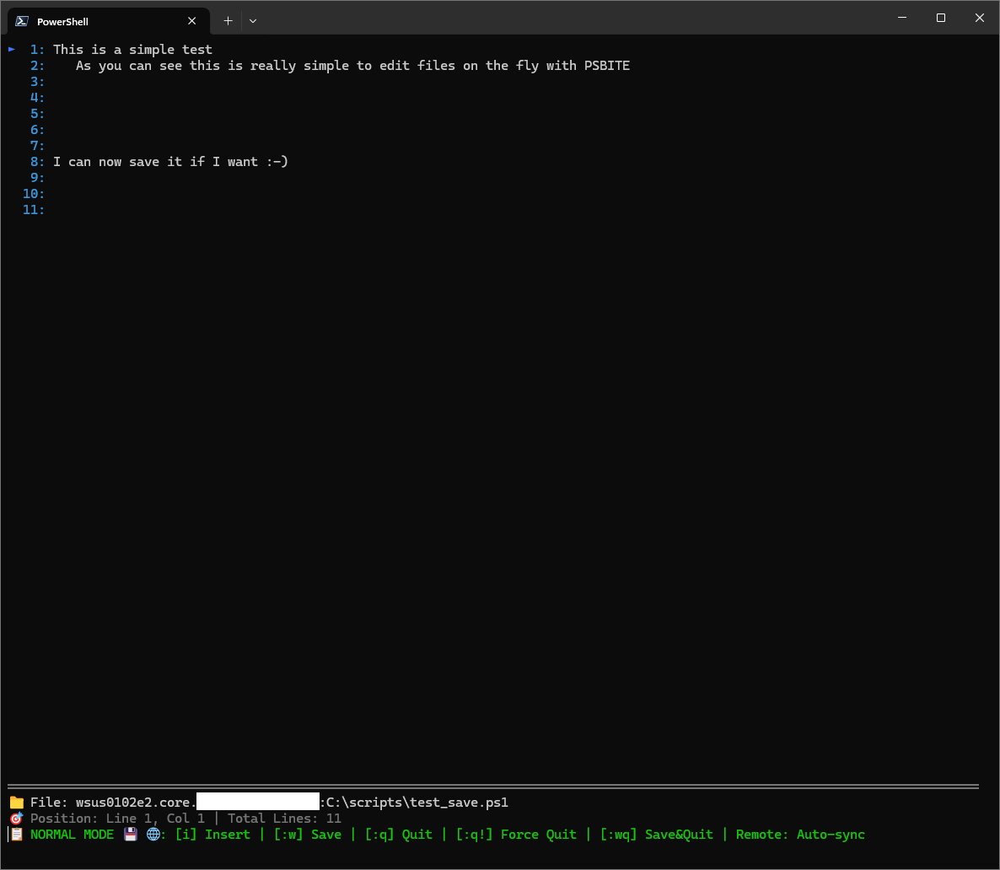
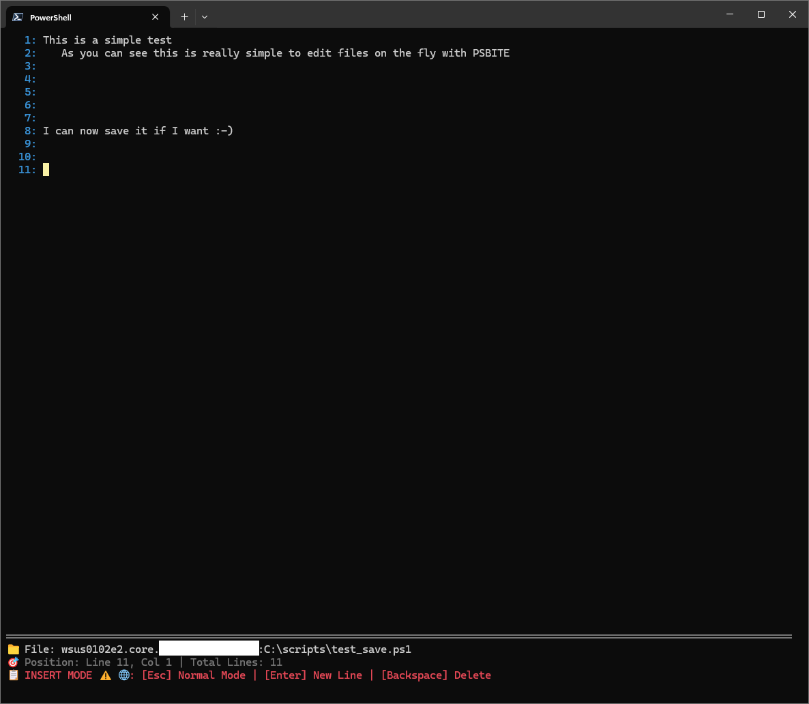
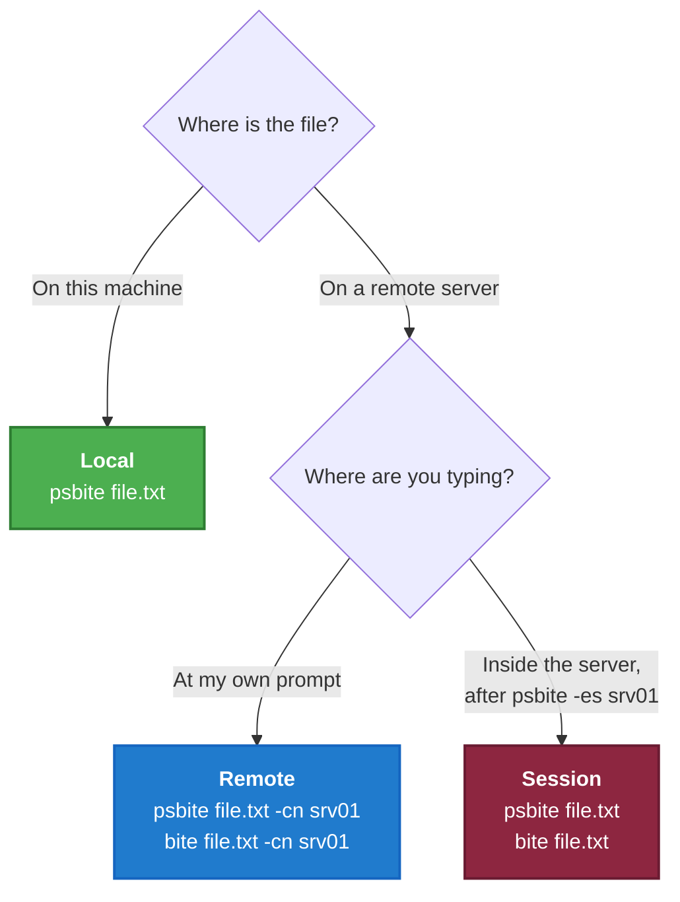
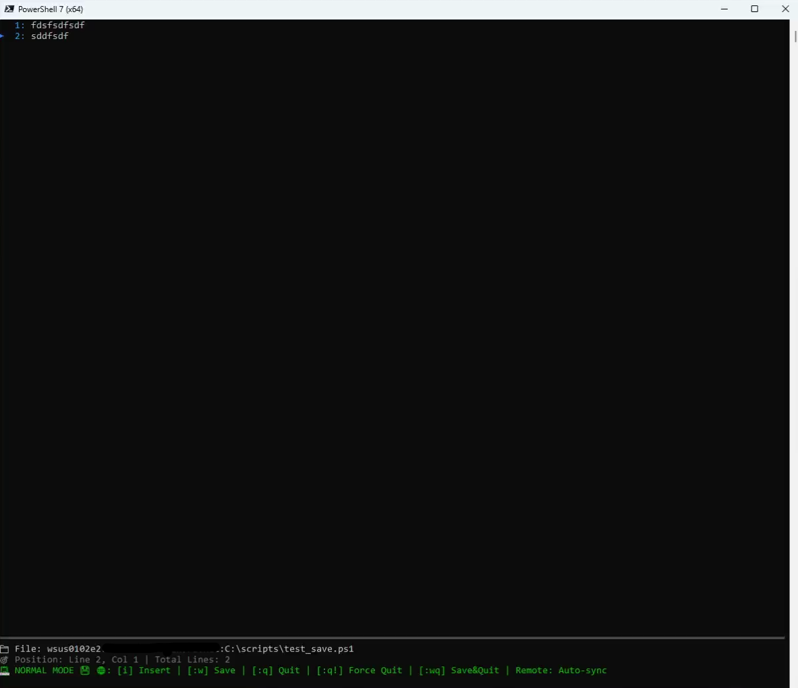
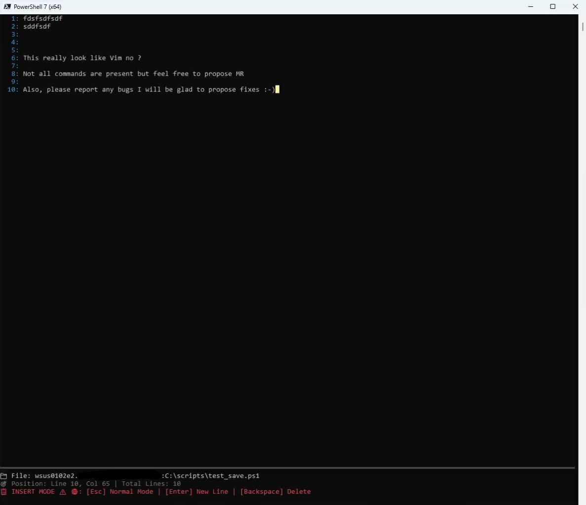
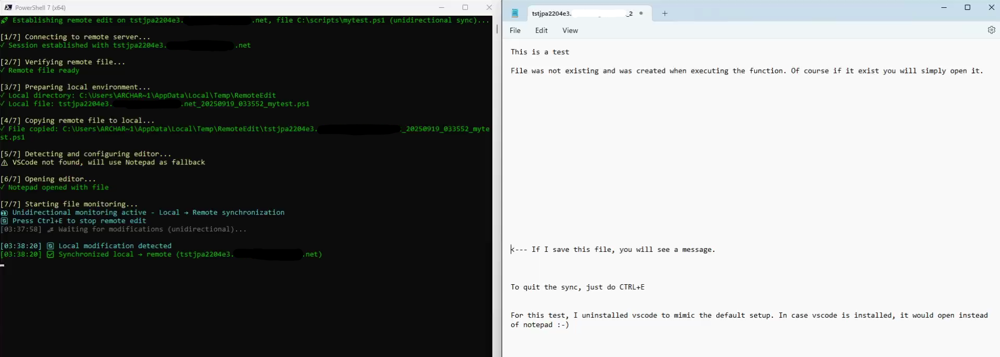
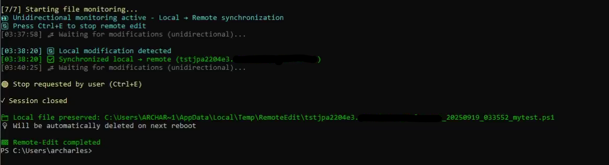
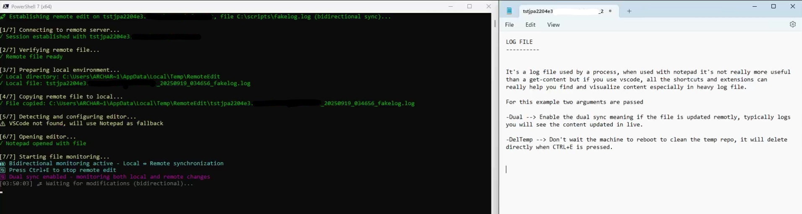

<div align="center">

# PSBITE

**PSBITE** stand for "**P**ower**S**hell **B**uffer **I**nsert **T**ext **E**ditor".
</div>

It's a VIM-like text editor that edits local files, remote files, and remote files from inside the
remote session itself. It provides a familiar VIM interface with NORMAL and INSERT modes, character
operations, and real-time remote synchronization.


<p align="center">  </p>

<div align="center">


</div>
<br>
<br>

💡 Included : Another function, **Edit-RemoteFile** is providing another way to remotely **open/editing** file with **VSCode** (or notepad) using **WinRM**.

## 👀 What it look like

<p align="center">  </p>

**>_ Windows Terminal**
<p align="center">  </p>

<p align="center">  </p>


## 💪 Advantages

<table align="center">
<tr>
<td align="center" style="color: #8d2640ff">🔗<br><b>No dependency</b></td>
<td align="center" style="color: #6a741cff">🔒<br><b>Secure</b></td>
<td align="center" style="color: #3d9393ff">⌨️<br><b>Keyboard only</b></td>
<td align="center" style="color: #207bcd">📝<br><b>Vim like</b></td>
<td align="center" style="color: #20cda8ff">🫧<br><b>Lightweight</b></td>
</tr>
</table>

## 📄 Prerequisites

- Require PowerShell 7

## 📦 Installation

To install the module from the [PowerShell Gallery](https://www.powershellgallery.com/packages/PSBITE/), you can use the following command:

```powershell
Install-PSResource -Name PSBITE
Import-Module -Name PSBITE
```

💡 Feel free to create an alias in your profile `vim`, `bite`, `psb`, `teub` !

## 🧭 Three ways to edit

> **The editor always runs on your machine.** In every mode, the UI appears in your own terminal
> (or your own VSCode). Nothing is ever installed on the remote server. What changes is only
> **where the file lives** and **where you type the command**.



| | 💻 Local<br/><sub>file on this machine</sub> | 🌐 Remote<br/><sub>from your prompt</sub> | 🛰️ Session<br/><sub>from the remote prompt</sub> |
|---|:---:|:---:|:---:|
| **Start-PSBite** <sub>(`psbite`)</sub><br/><sub>terminal editor</sub> | ✅ | ✅ | ✅ |
| **Edit-RemoteFile** <sub>(`bite`)</sub><br/><sub>VSCode / Notepad</sub> | ➖ | ✅ | ✅ |
| **Where the UI opens** | Your terminal | Your terminal / Your VSCode | Your terminal / Your VSCode |

➖ `Edit-RemoteFile` is remote-only by design: it exists to bridge a remote file to a local
graphical editor. For a local file, just open it directly.

In **Session** mode you first enter the server, then call the commands from its prompt. Relative
paths are resolved on the remote side, so `.\test.txt` means what you expect:

```powershell
psbite -es "server01"
[server01]: PS C:\> # Do any command you like
[server01]: PS C:\> # And you can edit when you need it
[server01]: PS C:\> psbite .\test.txt
```

It's like PSBITE is replacing the Enter-PSSession and you can edit files also from the psbite alias.

## 🔩 Example of Usage

Here is a list of example that are typical use cases for the module.

<p align="left" style="color: #356ebeff; font-size: 24px;">Using PSBITE 〲</p>

Edit a remote file with real-time synchronization

```powershell
Start-PSBite -FilePath "C:\scripts\remote.ps1" -ComputerName "server01"
```

Or drive PSBITE from *inside* a remote session, the editor still runs on your machine

```powershell
psbite -es "server01"
[server01]: PS C:\> psbite .\remote.ps1
```

**Opening a file in Normal Mode**


**Editing the same file**


<br>

-------------------------

<br>

<p align="left" style="color: #356ebeff; font-size: 24px;">Using Edit-RemoteFile 〲</p>

<p align="center">  </p>

Edit with bidirectional synchronization (remote changes are pulled to local)

```powershell
Edit-RemoteFile -ComputerName "server01" -RemotePath "C:\Scripts\test.ps1" -Dual
```
**Simple example of Edit-RemoteFile**


**Showing the ending process**


**Showing the Dual and DelTemp, used on a logs**



### Find more examples

To find more examples of how to use the module, please refer to the [examples](examples) folder.

Alternatively, you can use the Get-Command -Module 'PSBITE' to find more commands that are available in the module.
To find examples of each of the commands you can use Get-Help -Examples 'CommandName'.


## 📌 How to use it

### Edit-RemoteFile
```powershell
.PARAMETER ComputerName
# Remote server name or FQDN

.PARAMETER RemotePath
# Full path to the file on the remote server

.PARAMETER LocalTempDir
# Local temporary directory for file synchronization (default: $env:TEMP\RemoteEdit)

.PARAMETER UseSSL
# Use SSL for WinRM connection (default: true)

.PARAMETER Credential
# Credentials to use for the remote connection (default: current user)

.PARAMETER SkipCertificateCheck
# Skip SSL/TLS certificate verification, needed for self-signed certificates

.PARAMETER DelTemp
# Delete temporary file when finished (default: false - file is preserved)

.PARAMETER Dual
# Enable bidirectional synchronization - monitors both local and remote file changes

.PARAMETER Silent
# Minimal output - show only essential connection and monitoring messages

.PARAMETER Verbose
# Enable verbose output for debugging and detailed information. SO AJ :-)

.EXAMPLE
Edit-RemoteFile -ComputerName "server01" -RemotePath "C:\Scripts\test.ps1"
# Edit a remote PowerShell script with SSL and unidirectional sync

.EXAMPLE
Edit-RemoteFile -ComputerName "server01" -RemotePath "C:\Scripts\test.ps1" -Dual
# Edit with bidirectional synchronization (remote changes are pulled to local)

.EXAMPLE
Edit-RemoteFile -ComputerName "server01" -RemotePath "C:\Scripts\test.ps1" -Silent
# Edit with minimal output showing only essential messages

.EXAMPLE
Edit-RemoteFile -ComputerName "server01" -RemotePath "C:\Scripts\test.ps1" -DelTemp
# Edit and delete temporary file when finished

.EXAMPLE
Edit-RemoteFile -ComputerName "server01" -RemotePath "C:\Scripts\test.ps1" -Verbose
# Edit with verbose output showing file paths

.EXAMPLE
Edit-RemoteFile -ComputerName "lab01" -RemotePath "C:\Scripts\test.ps1" -Credential $cred -SkipCertificateCheck
# Edit on a host using explicit credentials and a self-signed certificate
```

### Start-PSBite
```powershell
.PARAMETER FilePath
# Path to the file to edit (local or remote). Can be relative or absolute for local but must be absolute when using the remote.

.PARAMETER ComputerName
# Remote computer name for remote editing (optional)

.PARAMETER UseSSL
# Use SSL for remote connection (default: true)

.PARAMETER Credential
# Credentials to use for the remote connection (default: current user)

.PARAMETER SkipCertificateCheck
# Skip SSL/TLS certificate verification, needed for self-signed certificates

.PARAMETER EnterSession
# Enter an interactive session on -ComputerName instead of opening a file (alias: es)
# In this mode -ComputerName is positional, so: psbite -es server01

.EXAMPLE
Start-PSBite -FilePath "C:\test.txt"
# Edit a local file

.EXAMPLE
Start-PSBite -FilePath "C:\scripts\remote.ps1" -ComputerName "server01"
# Edit a remote file with real-time synchronization

.EXAMPLE
Start-PSBite -ComputerName "server01" -EnterSession
# Enter server01, then edit from the remote prompt with: psbite .\test.txt

.EXAMPLE
psbite -es server01
# Same thing, short form: ComputerName is positional when entering a session

.NOTES
# Controls:
- i       : Enter INSERT mode
- Esc     : Enter NORMAL mode
- y       : Yank (copy) line
- dd      : Delete line
- p       : Paste line
- :w      : Save file
- :q      : Quit
- :q!     : Quit without saving
- :wq     : Save and quit
```

## 🛰️ Session mode

The local and remote modes are driven from your own prompt: you name the server, PSBITE goes and
gets the file. Session mode is the other way around. You enter the remote server like with
`Enter-PSSession`, and from *there* you call the PSBITE commands, which still execute on your
machine against the remote path.

```powershell
Start-PSBite -ComputerName "server01" -EnterSession
psbite -es "server01"                            # same thing, short form

[server01]: PS C:\> psbite .\test.txt            # PSBITE editor, in your terminal
[server01]: PS C:\> bite C:\logs\app.log         # VSCode / Notepad, on your desktop
[server01]: PS C:\> exit
```

A few things worth knowing:

- Both `Start-PSBite` / `psbite` and `Edit-RemoteFile` / `bite` are defined inside the session.
- The remote prompt stays blocked while the editor is open.
- `-ComputerName` is positional here, but stays named in the editing modes, so
  `psbite some-file.txt` is always a local edit and never a connection attempt.
- The session's own connection options are reused by the commands called inside it, so a host
  needing explicit credentials or a self-signed certificate works the same way:
  `psbite -es "lab01" -Credential $cred -SkipCertificateCheck`

Nothing is installed or configured on the remote server, everything is set up from local code. It
works by defining those commands in the session so that calling them raises an event back to your
host, which then runs the real command locally.

> ⚠️ Any code running in that remote session can invoke the callbacks, so only use it against hosts
> you trust.

## ⚔️ How Edit-RemoteFile differ from Start-PSBite ?

[Three ways to edit](#-three-ways-to-edit) covers *when* to reach for each one. This is *how* they
differ internally: they don't use the same method to work. PSBite is a VI like that capture the key
touched to do action where Edit-RemoteFile monitor the file to take action.

| Start-PSBite | Edit-RemoteFile |
|---|---|
| 🎹 Built-in editor | 📁 External monitoring |
| ⌨️ Responds to keystrokes | 👁️ Monitors the file |
| 📝 Direct editing | 🔄 Change detection |
| 💾 AutoSave timer | 📊 Polling timestamp |
| 🖥️ Terminal interface | 🔗 VSCode/Notepad |
| 💻 Local, 🌐 remote and 🛰️ session | 🌐 remote and 🛰️ session only |


## 📰 How it started

Since I was using core server, as soon as you need to manipulate file, logs or create file without GUI it was honestly a nightmare for me. I was not able to find something like nano built-in or even depending on VSCode. Because I'm working in a high secure area, we cannot afford to install cosmetic or non approved software like Vim on each servers. This is where the creation of this module started, because custom and selfmade PowerShell module are already running why not creating mine that can benefit my daily work and help the community ?

It was like a challenge after attempting [PSConf](https://psconf.eu/), I wanted to make something that was able to make me proud and ready to myself go on stage next time.

Then Edit-RemoteFile came alive in parallel for the same reasons, mainly for internal usage but finally integrated to PSBite because it's working not the same way and can also benefit to other users.


## 🔗 Functions dependencies

See [Function Dependencies](DEPENDENCIES.md) to understand link between each functions.


## 🔧 Contributing

Coder or not, you can contribute to the project! We welcome all contributions.

### 🧑‍💻 For Users

If you don't code, you still sit on valuable information that can make this project even better. If you experience that the
product does unexpected things, throw errors or is missing functionality, you can help by submitting bugs and feature requests.
Please see the issues tab on this project and submit a new issue that matches your needs.

### 🧑‍🔧 For Developers

If you do code, we'd love to have your contributions. Please read the [Contribution guidelines](CONTRIBUTING.md) for more information.
You can either help by picking up an existing issue or submit a new one if you have an idea for a new feature or improvement.

## 📣 Ref

Thanks to [Marius](https://github.com/MariusStorhaug) for his job on [PsModule Framework](https://psmodule.io/ ) used to built the skeleton of PSBITE.

Thanks to [Jordan Borean](https://github.com/jborean93) for the session callback mechanism behind
the session mode, shared in [issue #13](https://github.com/arnaudcharles/PSBITE/issues/13) and
vendored under the MIT License, see [THIRD_PARTY_NOTICES.md](THIRD_PARTY_NOTICES.md).

Thanks to my colleagues who challenged me, helped me publish it and using it daily.
